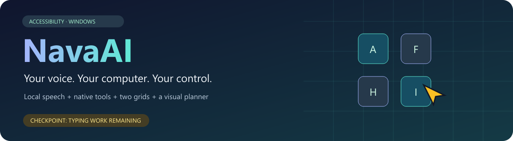
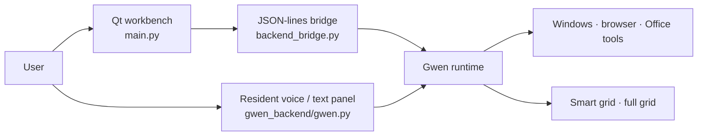
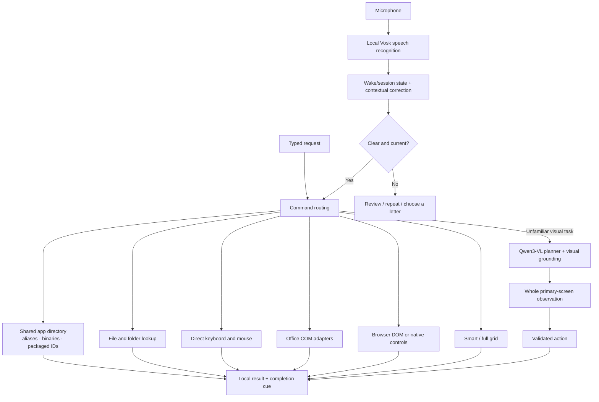

<div align="center">



# NavaAI · Gwen control runtime

**Hands-free Windows access, with direct control whenever you want it.**


[Setup](#start-here) · [Architecture](#how-it-works) · [Commands](#command-playbook) · [Modules](#what-does-what) · [Remaining work](#what-still-needs-work)

</div>

> **Checkpoint · 8 November 2026 · `typing-work-remaining`**
> This branch preserves the existing NavaAI Qt workbench and bundles the current Gwen backend, settings, models, grids and offline speech work. It is an active development checkpoint. Typing and real-microphone reliability still need live validation; automated tests do not prove every spoken request or application works.

## The idea

The goal is **hands-free computer access** for people who cannot comfortably use a mouse and keyboard, and for use from across a room. Ask for a result in ordinary language, or take direct control using labeled targets and a full-screen grid.

| Ask for a result | Decide the movement yourself |
|---|---|
| “Open WhatsApp.” | “Gwen grid.” → “Open AF.” |
| “Make E5 bold.” | “Gwen full grid.” → “Click C3.” |
| “Switch to the YouTube tab.” | “Scroll down from FG.” |
| “Close Word.” → confirm | “Hold A.” → “Move to F.” → “Release.” |

The grids complement the app, browser and Office tools. Users choose how much control to delegate.

## Two interfaces, one backend



| Interface | Launch | Voice behavior | Best use |
|---|---|---|---|
| **NavaAI workbench** | Root `Start NavaAI.cmd` | Current bridge is **typing-only** | Window selection, sessions and full desktop UI |
| **Gwen resident assistant** | `gwen_backend/Start Gwen.cmd` | Offline speech, wake/session commands and mic settings | Hands-free use and testing the latest voice work |

**Run one controller at a time.** They share a single-instance guard for the selected backend. Quit resident Gwen before connecting the workbench to that backend. The workbench's older grid-launch behavior can differ from the resident panel; [its original guide is preserved here](docs/WORKBENCH.md).

## How it works



**Simple actions bypass Qwen.** Typing, shortcuts, app matching, grids and supported native tools have deterministic routes. Visual planning can take substantially longer.

**Local speech does not make every task offline.** Speech/model inference are local; websites, searches, stores and other apps can still use the network.

## Start here

### 1. Clone this branch and download LFS assets

Model assets occupy approximately **1.94 GB** on disk. Git LFS stores them outside ordinary Git blobs.

```powershell
git lfs install
git clone --branch typing-work-remaining --single-branch https://github.com/ZahraRehmat/NavaAI.git
cd NavaAI
git lfs pull
```

A tiny file beginning `version https://git-lfs.github.com/spec/v1` is a pointer, not a usable model. Finish the LFS download before starting inference.

### 2. Install the backend environment

The development machine uses **Windows and Python 3.12**. Dependency versions are captured, but a new machine's audio devices, installed apps, Office version and GPU drivers still need validation.

```powershell
py -3.12 -m venv gwen_backend/.venv
.\gwen_backend\.venv\Scripts\python.exe -m pip install -r gwen_backend/requirements-lock.txt
.\gwen_backend\.venv\Scripts\python.exe -m playwright install chromium
```

`requirements.txt` lists direct runtime dependencies; `requirements-lock.txt` captures the fuller environment. Office tools require the corresponding desktop Office app. GPU inference needs compatible OpenVINO/device support; CPU recovery has different performance.

### 3. Choose a controller

<details open>
<summary><b>Resident voice assistant</b></summary>

```powershell
.\gwen_backend\.venv\Scripts\pythonw.exe gwen_backend/gwen.py
```

Or double-click **`gwen_backend/Start Gwen.cmd`**. A top-right badge appears while the main panel stays hidden. **F10** shows the panel.

1. Open **Mic…** and choose an **input** device. Earphone speakers do not prove the earphone microphone is active.
2. Watch the audio meter while speaking.
3. Say **“Gwen listen”** once for continuous commands, or use **“Gwen, &lt;command&gt;”**.
4. Wait for task completion before the next action. Say **“stop”** or press **F8** to request cancellation.

The saved `voice_config.json` includes the development listening preference. Review it on another PC; microphone IDs are not portable.

</details>

<details>
<summary><b>Qt desktop workbench</b></summary>

Create a separate frontend environment:

```powershell
py -3.12 -m venv .venv
.\.venv\Scripts\python.exe -m pip install -r requirements.txt
.\.venv\Scripts\python.exe main.py
```

The workbench now discovers the bundled `gwen_backend/` first. If needed, select it in Preferences. It must contain `agent.py`, `config.json` and `.venv/Scripts/python.exe`.

The current workbench bridge remains **typing-only**. Bundling the voice backend does not automatically connect speech to the Qt UI. [Workbench guide →](docs/WORKBENCH.md)

</details>

### Badge, beeps and hotkeys

| Indicator | Meaning |
|---|---|
| 🟢 Listening | Continuous commands enabled; microphone stream open |
| 🔵 Say Gwen listen | Microphone open; commands need the wake name |
| 🟣 Hearing you / Dictating | Recognizing speech, or explicit dictation mode |
| 🟡 Working / Needs reply | Active task or required choice/confirmation |
| 🔴 Mic error | Audio or recognition reported an error |
| ⚪ Voice off / Starting | Disabled microphone or initialization |

The badge includes a live audio meter. It is click-through and does not take focus. The thick cursor halo starts with Gwen and changes color during work. A short completion beep and an attention cue replace focus-stealing panel popups.

| Key | Action |
|---|---|
| **F8** | Stop task, release held mouse buttons and exit grids |
| **F9** | Toggle offline voice |
| **F10** | Show/hide resident panel |

F8/“stop” does not put continuous listening to sleep. **“Gwen sleep”** or microphone off ends the session. Cancellation during model loading/inference is cooperative and may not return immediately.

## Command playbook

### Apps, windows, files and folders

```text
open Chat GPT
open Whats App
open vs code
switch to Word
open gwen three folder
open FYP folder
open README.md
close Word
quit Chrome
stop Notepad
force close Notepad
```

- Opening, switching and closing share the app directory and aliases. Spaces/punctuation do not distinguish product identity: **Chat GPT / Chat G P T / ChatGPT**, **Whats App / WhatsApp**.
- Long names can match installed executable names or packaged app IDs when titles only show documents. Approximate matching is bounded; ambiguity asks for a choice.
- Normal close asks once and sends Windows a close request. Save/Don't Save/Cancel remain for the user. Some apps hide to the tray instead of exiting.
- **Force close / terminate** is explicit, separately confirmed, and can discard unsaved work. It targets the selected process, not an arbitrary process tree. Protected Windows processes and the desktop shell are excluded.
- Folder lookup respects OneDrive Desktop redirection and current Explorer locations. **“gwen three”** can match **“gwen 3.”** Nearby folders can produce a choice rather than an invented path.

### Smart grid · controls become labels

```text
Gwen grid
A
open AF
right click H
scroll down from FG
hold A
move to F
release
exit grid
```

Native accessibility controls across apps, Start, taskbars, shell flyouts and exposed desktop icons receive labels. The observer listens for Windows changes, caches unchanged roots, isolates UIA in a helper process and checks target bounds before input.

**Initial speech-friendly labels:** `A F H I L M O Q R U W B`. Similar-sounding D/T/G/J are deferred until that set is allocated. Singles precede pairs/triples. Labels stay attached to control identity and are not recycled onto unrelated targets during an activation.

| Say | Do |
|---|---|
| `A` / `click A` / `press A` / `select A` | Move and single-click |
| `open A` / `double click A` | Move and double-click |
| `move to A` | Move only |
| `scroll down from A` | Wheel there without clicking |
| `hold A`, then another label | Hold and move for dragging |
| `release` | Release held buttons |

Explorer AppBars, Start's SemanticZoom container and popup roots are included. Compact Explorer rows prefer filename text over row centres, checkboxes or inline action areas. Disabled controls remain excluded.

In the resident assistant, ordinary commands coexist with grids. If `open <name>` has no observed smart target, the app/file/folder directory can handle it. Bare labels remain mouse actions. [Smart-grid details →](gwen_backend/SMART_GRID.md)

### Full grid · every display point gets a cell

```text
Gwen full grid
click C3
double click G4
scroll down on G4
zoom C3
move right 5
drag C3 to E3
exit grid
```

Default density is **40 × 25 cells per display**—about 48 × 48 pixels at 1920 × 1200. Zoom, pixel nudges and exact pixel commands provide finer control. Monitor geometry includes negative coordinates. Every display pixel belongs to a cell; a click still targets one point inside that cell. [Full-grid details →](gwen_backend/FULL_GRID.md)

### Typing and dictation · the focused work area

```text
type Hello world
press enter
select all
paste
go back
go forward
go up
go home
```

For multiple phrases:

```text
type
[wait for the cue]
Hello world
This is another phrase
stop dictation
```

Bare **“type”** or **“start dictation”** enters dictation mode. Subsequent phrases use the unrestricted offline decoder and are typed literally—including phrases that sound like commands. **“Stop dictation” / “finish typing”** returns to commands; bare “stop” also ends dictation. This mode is not persisted across restarts.

Focus the intended input first. Grids can stay on. Speech captured while another typing action is busy is reviewed rather than queued into a later field. **This remains the main area of live testing.**

### Browsers and Office

| Area | Examples | Route |
|---|---|---|
| Navigation | `open youtube.com`, `search cats` | Existing-window navigation or managed browser |
| Tabs | `open new tab`, `close current tab`, `switch to YouTube tab` | Managed DOM or native tab controls |
| Media | `pause video`, `resume video` | Exposed controls / managed-page state |
| Excel | `select cell E5`, `make E5 bold`, `delete cells E5:F6 shift up` | Supported Office COM tools |
| Word | `insert a table with three rows and two columns`, `change table outline colour to blue` | Supported Office COM tools |
| PowerPoint | Supported formatting, tables and slide commands | Supported Office COM tools |

An ordinary Chrome/Edge window is **not automatically DOM-connected**. Managed sessions use a separate profile; ordinary browsers use supported native controls and shortcuts. The Office catalog indexes many controls, but an indexed entry is **not** a guarantee of an executable action in every view.

[Office capabilities →](gwen_backend/OFFICE_CAPABILITIES.md) · [Offline voice →](gwen_backend/OFFLINE_VOICE.md)

## What does what

Backend filenames below are inside `gwen_backend/`.

| Module / directory | Responsibility |
|---|---|
| Root `main.py`, `workbench_ui.py`, `styles.py` | Qt workbench and presentation |
| Root `project_state.py`, `target_policy.py` | Frontend state, backend discovery and selected-window policy |
| Root `backend_bridge.py` | JSON-lines adapter into Gwen |
| `gwen.py`, `typed_ui.py`, `app_runtime.py` | Resident panel, worker/event queues and single instance |
| `speech.py`, `vosk_speech.py` | Microphone capture, segmentation and local recognition |
| `command_voice.py`, `speech_context.py` | Session state, dictation, confidence review and contextual code correction |
| `status_indicator.py`, `task_feedback.py`, `cursor_marker.py` | Passive badge/meter, beeps and pointer halo |
| `agent.py`, `routing.py`, `direct_commands.py` | Dispatch to tools before model planning |
| `catalog.py`, `app_identity.py`, `window_commands.py` | App directory, aliases, matching, switching and closing |
| `file_control.py`, `folder_control.py`, `label_matching.py`, `target_choices.py` | Filesystem lookup, fuzzy labels and ambiguity handling |
| `smart_grid.py`, `smart_grid_observer.py`, `grid_branch_scan.py` | Adaptive map, isolated UIA scanner and bounded traversal |
| `smart_labels.py`, `smart_grid_names.py` | Speech-friendly labels and named grid commands |
| `full_grid.py`, `grid_geometry.py`, `grid_commands.py` | Display partitioning and manual grid language |
| `grid_overlay.py`, `grid_mouse.py`, `grid_events.py`, `grid_roots.py` | Passive overlays, physical input, events and window discovery |
| `accessibility.py`, `visual_targets.py`, `windows_api.py` | UIA, local OCR and Win32 helpers |
| `browser_control.py`, `browser_commands.py`, `native_browser.py` | DOM sessions, tab/media intents and ordinary browser controls |
| `office_control.py`, `office_language.py`, `office_tools.py`, `office_catalog.py` | Office adapters, commands and reference catalog |
| `planner.py`, `action_schema.py`, `actions.py` | Qwen planning, grounding, parsing and validation |
| `startup.py` | Optional current-user startup after sign-in |
| `models/`, `data/office_controls/` | Local model assets and Office reference data |
| `test_*.py`, `verify_*.py` | Regressions and explicitly invoked verification fixtures |

## Models and settings

| File / asset | Purpose |
|---|---|
| `config.json` | Qwen path, requested device and planning/image limits |
| `voice_config.json` | Vosk model, microphone, listening preference, silence and review thresholds |
| `full_grid_config.json` | Grid density, colors and labels |
| `apps.json` + `app_catalog.ps1` | App inventory and Windows catalog collection |
| `aliases.json`, `label_aliases.json` | App nicknames and label aliases |
| `models/Qwen3-VL-2B-Instruct-ov-int4/` | Existing Qwen OpenVINO INT4 export |
| `models/vosk-model-small-en-us-0.15/` | Default lightweight offline command model |
| `models/whisper-tiny.en/` | Retained compatibility model; not the default command engine |

This is an existing Qwen export, **not evidence of custom model training**. Model assets retain their upstream terms; see bundled model/source metadata and [Qwen](https://huggingface.co/Qwen/Qwen3-VL-2B-Instruct), [Vosk](https://alphacephei.com/vosk/models) and [faster-whisper](https://github.com/SYSTRAN/faster-whisper).

On another PC, choose the microphone and regenerate the app inventory rather than assuming development paths are valid. From `gwen_backend/`:

```powershell
.\.venv\Scripts\python.exe -c "from catalog import Catalog; Catalog.refresh()"
```

## What still needs work

| Priority | Work remaining | Why it matters |
|---|---|---|
| **P0** | Live dictation/focused-field tests across editors, browser inputs and Office | Correct routing is not proof text reached the intended field |
| **P0** | Human accents, distance, earphone microphones and room noise | Synthetic speech does not represent every user |
| **P0** | Desktop-grid and tray-flyout checks across Windows layouts | Providers and shell versions expose different trees |
| **P1** | Clearer review, busy and cancellation recovery | Distinguish uncertainty, a chooser, model loading and an unresponsive app |
| **P1** | Unify resident voice behavior with the Qt frontend | Current workbench bridge is typing-only |
| **P1** | Broader browser and Office task coverage | Native/DOM/COM support varies with app and view |
| **P2** | Repeatable packaging and fresh-PC setup | Dependencies, LFS models, discovery and startup need installation testing |

**Known limits:** Vosk can give high confidence to wrong words. Qwen can choose an incorrect visual target. UIA can omit custom controls. Refresh is best-effort, not instantaneous. Close can hide an app to its tray. Long model operations can delay cancellation. The normal desktop process does not control Windows' secure sign-in desktop.

Gwen's startup shortcut runs **after sign-in**. Before-sign-in voice control requires Windows Voice Access or a separately trusted accessibility component. [Startup/sign-in guide →](gwen_backend/STARTUP_AND_SIGN_IN.md)

## Tests and evidence

The development snapshot passed **236 backend automated tests**, plus the synthetic offline speech verifier. A read-only live check found **49 desktop items**, and folder matching resolved “gwen three” to the existing `gwen 3` folder.

These are bounded checks, not proof of reliable end-to-end use across every app. Live desktop-overlay visibility and real-user dictation remain to be validated. Original frontend evidence is described separately in [VERIFICATION.md](VERIFICATION.md).

From `gwen_backend/`:

```powershell
.\.venv\Scripts\python.exe -m unittest discover -p "test_*.py" -q
.\.venv\Scripts\python.exe verify_offline_commands.py
```

The speech verifier generates temporary Windows SAPI audio, blocks Python socket connections during recognition/model loading, checks routing, and removes temporary audio. It does not execute the recognized computer commands. Native unit fixtures can briefly create passive windows; the force-stop test only terminates its own disposable child process.

From the root, with the frontend environment:

```powershell
.\.venv\Scripts\python.exe -m unittest test_workbench -q
```

Other `verify_*.py` scripts can open fixture apps or move the pointer. Read the intended verifier before running it alongside personal work.

### Local diagnostic trail

| Local file under `gwen_backend/logs/` | Records |
|---|---|
| `voice-decisions.jsonl` | Recognized words/confidence and routing decisions |
| `task-results.jsonl` | Completed task, returned result/error and duration |
| `voice_runtime.json` | Mic device/level, listening state and current task |
| `session-*.jsonl` | Backend routes, model actions and execution details |

Live microphone audio stays in memory rather than being recorded. Transcripts and observations can still contain private information. Logs, browser profiles, credentials, recovery keys, caches, virtual environments and the encrypted personal-runtime archive are excluded from this public snapshot. Included WAVs are synthetic fixtures, not live recordings.

[Snapshot manifest →](docs/SNAPSHOT_MANIFEST.json). Older checkpoint-restore scripts remain as source, but their external private archive is not included.

## Branch map

```text
NavaAI/
├── README.md                       ← branch guide
├── main.py / workbench_ui.py        ← Qt workbench
├── backend_bridge.py
├── project_state.py
├── requirements.txt                ← frontend dependencies
├── docs/
│   ├── assets/nava-banner.svg
│   ├── WORKBENCH.md                 ← preserved original guide
│   └── SNAPSHOT_MANIFEST.json
└── gwen_backend/
    ├── gwen.py / typed_ui.py        ← resident controller
    ├── agent.py
    ├── models/                     ← Git LFS
    ├── data/office_controls/
    ├── config.json / voice_config.json
    ├── requirements-lock.txt
    ├── test_*.py / verify_*.py
    └── SMART_GRID.md / FULL_GRID.md / OFFLINE_VOICE.md
```

---

<div align="center">

**Access. Choice. Control.**<br/>
Ask for the result—or use the grids to decide every movement yourself.

</div>
