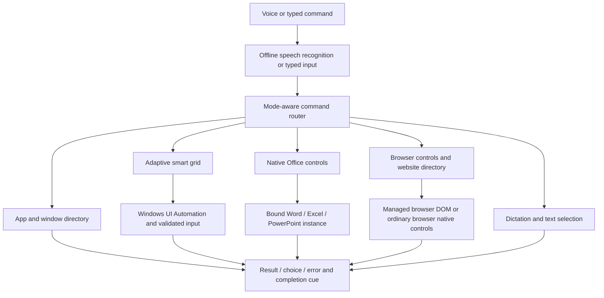

# NavaAI · Hands-free Windows control

> **Speak. Select. Type. Navigate.** A local accessibility assistant combining direct commands, an adaptive smart grid and offline dictation.

**Current snapshot · 9 November 2026**

**Windows desktop · CPU-based speech · No Qwen runtime or Qwen weights**

The product is called NavaAI. The current executable, UI and wake phrases still use **Gwen**. Renaming them to **Nava / Nava AI** is planned, not implemented. See [Remaining work](REMAINING_WORK.md).

## What this system is

NavaAI is a custom automation assistant, not a newly trained general-purpose AI model. Rules, aliases, confidence checks and native tools dispatch supported commands. Pretrained speech models convert voice to text; a separate model restores punctuation when requested. There is no Qwen inference, visual planner or model-generated Office plan in the running assistant.



## Capability map

| Area | Implemented behavior | Examples / practical limits |
|---|---|---|
| Power and voice | Resident badge, continuous listening, wake-only standby, stop and completion beep | `Gwen turn on`, `Gwen turn off`, `Gwen listen`; off keeps a wake listener, while microphone off/quit stops capture |
| Apps and windows | Installed-app directory, common aliases, launch, switch, minimize, maximize, restore and confirmed close | `open Chrome`, `switch to Word`, `maximize this app`; multiple matching windows use choices |
| Files and folders | Current/known locations, normalized names, optional extensions in supported matching and ambiguous-target choices | `open FYP`, `open Date Sheet`; not a complete computer-wide semantic file index |
| Smart grid | UIA-based visible targets, stable speech-friendly labels, change refresh, click/move/drag/scroll | `open grid`, `A`, `open A`, `scroll down from A`; unsupported custom controls may remain unmarked |
| Excel worksheet | Native cell addresses replace cell grid labels; surrounding controls retain labels | `select G6`, `select B2 to N6`, `edit J7`, `copy cell C9`, `paste copied data in K10` |
| Excel tables | Convert selected or specified range to a formatted native table | Select a range, then `make a table`; existing table overlap and invalid ranges are rejected |
| Office dropdowns | Named font/font-size controls and marked dropdown chooser across shared Office ribbon providers | `open Font selection dropdown`, `open Font size dropdown`, `open dropdown` |
| Browser navigation | Search, URLs and cached 10,000-domain website directory for Chrome/Edge | `open Wikipedia on Edge`, `search cats on Chrome`; website loads still need internet |
| Browser tabs/media | New/close/switch tabs, named/indexed tab operations and supported video controls | `open new tab`, `select tab two`, `close current tab`, `pause the video`; sites/providers vary |
| Dictation | Offline Whisper, phrase joining, explicit Enter, last-word erase and optional punctuation | `dictation on`, speak, `stop dictation`, `press enter`, `erase it`, `punctuate it` |
| Selection/clipboard | Native text ranges, repeated-word choices, supported browser DOM fallback, copy/paste | `select from Islamabad to Karachi`, `copy it`, `paste`; requires selectable text in the bound active app |

**The uniform full-screen row/column grid is removed.** Grid activation aliases open the adaptive smart grid. Excel worksheet cells deliberately use their native addresses instead of extra labels.

## Install and start

Use Windows with Python **3.12**, a working microphone and the applications you want to control. Desktop Office must be installed for its COM controls. No dedicated GPU is required by direct command execution or the current CPU voice configuration. Minimum hardware performance is not yet certified.

```powershell
git lfs install
git clone https://github.com/ZahraRehmat/NavaAI.git
cd NavaAI
git lfs pull
py -3.12 -m venv .venv
.\.venv\Scripts\python.exe -m pip install -r requirements.txt
.\.venv\Scripts\python.exe -m playwright install chromium
.\.venv\Scripts\python.exe -c "from catalog import Catalog; Catalog.refresh()"
.\.venv\Scripts\python.exe gwen.py
```

Then use **Start Gwen.cmd**. F10 opens the panel, F9 toggles voice, F8 stops work/releases the mouse. Keep the intended app/input field active before typing commands. `device: null` in `voice_config.json` uses the system's default microphone; select the correct Windows input device.

The clone contains the three active offline model directories through **Git LFS**. A ZIP download may contain pointers instead of weights; use the commands above. If models need to be downloaded separately:

```powershell
.\.venv\Scripts\python.exe setup_command_voice.py
.\.venv\Scripts\python.exe setup_dictation_voice.py
.\.venv\Scripts\python.exe setup_punctuation.py
```

Model/dependency installation needs internet. Once installed, speech and punctuation run locally. Browser tasks use the network as required by their websites. Setup scripts are manual downloads, not background runtime downloads.

## Everyday workflow

1. Start the assistant and say **Gwen turn on**.
2. Say **open Excel** or switch to an already open application.
3. Use direct commands when available: **select B2 to N6**, then **make a table**.
4. Say **open grid** when you want to choose a visible control directly. Speak its label; use **open LABEL** for a double-click.
5. Focus a text field, say **dictation on**, speak, then **stop dictation**. **Press enter** sends the real key; the target application decides its behavior.
6. Say **Gwen turn off** for standby, **microphone off** to stop capture, or quit the process completely.

Closing an app asks for confirmation and preserves normal save prompts. Explicit force-close is separate and can lose unsaved changes. Startup support runs **after Windows sign-in**; this assistant does not bypass secure desktop or Windows Hello restrictions.

## How the code is organized

| Modules / data | Responsibility |
|---|---|
| `gwen.py`, `typed_ui.py`, `status_indicator.py`, `task_feedback.py` | Resident UI, lifecycle, queues, badge and completion feedback |
| `speech.py`, `vosk_speech.py`, `hybrid_speech.py`, `command_voice.py` | Audio capture, command recognition, dictation/selection recognition and mode routing |
| `speech_context.py`, `voice_controls.py`, `dialog_voice.py` | Context vocabulary, explicit controls and voice answers to choices |
| `agent.py`, `routing.py`, `direct_commands.py` | Deterministic dispatch and supported direct operations |
| `catalog.py`, `app_catalog.ps1`, `app_identity.py`, `window_commands.py`, `windows_api.py` | Installed app discovery, aliases, window binding and activation |
| `file_control.py`, `folder_control.py`, `label_matching.py`, `actions.py` | File/folder lookup, matching and target safeguards |
| `smart_grid.py`, `smart_grid_observer.py`, `grid_branch_scan.py`, `grid_popup_scan.py`, `grid_events.py` | Isolated UIA scanning, popup roots, bounded traversal and refresh |
| `smart_labels.py`, `grid_overlay.py`, `grid_badge_layout.py`, `smart_mouse_actions.py`, `grid_input.py` | Label allocation, overlays and grid command dispatch |
| `browser_control.py`, `native_browser.py`, `browser_commands.py`, `website_directory.py` | Managed DOM/native browser paths, tabs/media and domain matching |
| `office_control.py`, `office_language.py`, `office_tools.py`, `excel_commands.py` | Supported Office actions and exact native Excel range operations |
| `dropdown_control.py`, `dropdown_choices.py`, `choice_ui.py` | Semantic dropdown expansion and marked ambiguity choices |
| `text_input.py`, `rendered_text.py`, `selection_hints.py` | Text selection, native geometry and browser selection fallback |
| `dictation_queue.py`, `unicode_keyboard.py`, `dictation_punctuation.py`, `punctuation_edit.py` | Bound typing, Unicode input and punctuation edits |
| `aliases.json`, `label_aliases.json`, `website_aliases.json`, `data/popular_websites.json` | Common names, matching aliases and website directory |
| `config.json`, `voice_config.json`, `smart_grid_config.json` | Direct execution, speech behavior and overlay preferences |

Some historical diagnostic/planner Python files remain for development reference. They are **not part of runtime dispatch**. Qwen weights and OpenVINO packages are excluded from this publication; old planner verification scripts require their old environment and are not current acceptance tests.

## Offline models and package contents

| Included model | Purpose | Approximate files size |
|---|---|---:|
| Vosk small English | Commands and constrained choices | 71 MB |
| Whisper base.en | English dictation and selection recognition | 148 MB |
| English punctuation ONNX + SentencePiece | Explicit punctuation restoration | 210 MB |

The published snapshot contains source, settings, tests, guides and these models. It excludes **Qwen**, the unused tiny Whisper copy, `.venv`, Git internals, private session logs/screenshots, voice recordings, browser profiles/cookies, GPU caches and checkpoint archives. `apps.json` is generated per PC rather than publishing one person's installed paths. An installed environment adds dependency space beyond repository files.

Model provenance is in their directories and setup scripts. Website source attribution is in [data/WEBSITES_SOURCE.md](data/WEBSITES_SOURCE.md). No claim is made that third-party models or libraries were trained/written by this project.

## Verification and honest limits

The latest focused suite passed **129 tests** on the development PC, covering Excel/table dispatch, grid traversal, dropdowns, direct-mode isolation, speech routing, browser tabs and selection-related paths. A read-only live Excel scan returned **122 surrounding controls and zero cell labels**, preserving font controls and sheet tabs. Previous isolated Excel checks exercised table creation, selection and rich copy/paste without editing the user's workbook.

Run that focused suite from this checkout:

```powershell
.\.venv\Scripts\python.exe -m unittest test_grid_branches test_excel_commands test_dropdown_choices test_dropdown_control test_font_dropdown_names test_grid_integration test_smart_grid test_voice_control_recognition test_direct_mode test_speech_context test_chrome_grid_tabs test_popup_grid test_smart_labels test_selection_mode test_voice_typing test_dialog_voice
```

These tests do not certify every app, accent, website or Windows build. Some cases use mocks/provider fixtures. A managed browser supports richer DOM access; an ordinary browser is not automatically DOM-connected. App activation, modal dialogs, accessibility providers and speech can still fail. Low-confidence recognition can require review, and custom/privileged interfaces may not expose usable controls. Active-app targeting is not independent two-app multitasking.

Local runtime logs may contain recognized text, file paths and window titles: keep them private. The assistant does not promise perfect recognition or universal Office feature coverage. See [REMAINING_WORK.md](REMAINING_WORK.md) for the next priorities.

## Detailed guides

- [Excel cells, tables and Office dropdowns](EXCEL_CONTROLS.md)
- [Office capabilities](OFFICE_CAPABILITIES.md)
- [Offline voice and dictation](OFFLINE_VOICE.md)
- [Smart grid](SMART_GRID.md)
- [Website directory](WEBSITES.md)
- [Startup and sign-in boundaries](STARTUP_AND_SIGN_IN.md)
- [Publication manifest](PUBLICATION_MANIFEST.json)

Older guides/development notes may describe earlier milestones; this README and the remaining-work list describe the published snapshot. No installer is provided yet.
