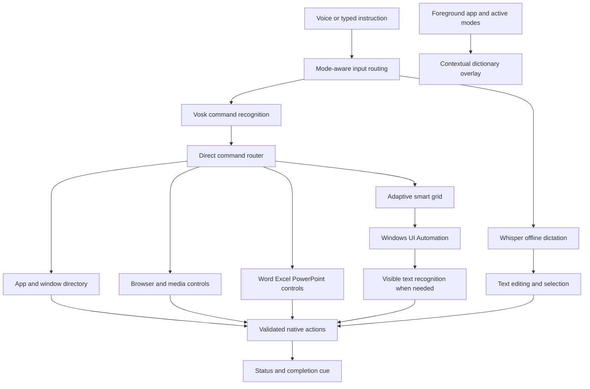
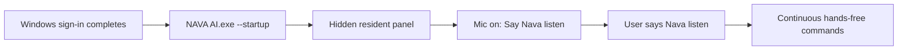

# NAVA AI — complete progress and release handoff

**Prepared 15 November 2026 · Main-branch consolidation · Installer preview 1.0**

> A hands-free Windows accessibility assistant: speak to operate applications, dictate text and navigate controls, with a smart grid when direct commands are not enough.

[Download the Windows x64 installer](https://github.com/ZahraRehmat/NavaAI/releases/download/v1.0.0-preview.1/NAVA-AI-Setup-1.0.0-win-x64.exe) · [Installer guide](installer/README.md) · [Complete command dictionary](COMMAND_DICTIONARY.md) · [Build and validation notes](INSTALLER.md)

## 1. What this main update contains

This snapshot consolidates the latest development sessions into `main`. The Nava rename, approved logo, startup profile and standalone installer were completed in today's work. The dictionary, feedback and taskbar refinements from the preceding session are included too. Earlier app, Office, browser, editing and grid modules remain part of the product; they are not presented as newly invented today.

| Area | Delivered behavior |
| --- | --- |
| Identity | **NAVA AI** is the display name; **Nava** is the command name. |
| Logo | Approved flat violet N artwork is used for the app EXE, installer and shortcuts. |
| Windows startup | Sign-in starts a hidden assistant with the microphone on and the badge **Say Nava listen**. |
| EXE distribution | One offline installer installs the existing application and its own runtime; no target-PC Python/pip/CMD setup. |
| Local discovery | Installation discovers the receiving PC's applications and known file locations. |
| Dictionary | Transparent, contextual app/mode guidance, searchable full manual, opacity and left/right commands. |
| Display order | Custom choices take priority; dictionary/grid drawings do not obscure them. |
| Status | Compact adaptive taskbar badge; no indefinite unanswered **Needs reply** state for rejected speech. |
| Release evidence | 212 focused checks, packaged dependency/asset checks and real install/upgrade/uninstall tests. |

## 2. The product architecture

NAVA AI is a custom automation application, not a newly trained general-purpose AI model. Rules, aliases, confidence checks, native automation and provider-backed screen information dispatch supported actions. Speech/OCR models perform narrowly defined recognition tasks. There is no Qwen inference or visual AI planner in the active application or installer.

## 3. Branding and exact wake commands

The badge, panel titles, dictionary, microphone selector, target chooser, cursor/grid windows, feedback text and current manuals use **NAVA AI**. The new launcher is **NAVA AI.exe** in an installed build, or **Start NAVA AI.cmd / nava.py** for source development.

| Say | Meaning |
| --- | --- |
| **Nava listen** | Enable continuous commands without repeating the wake name. |
| **Nava sleep** | Return to named commands; the microphone is still on. |
| **Nava turn on** | Activate the assistant and continuous commands. |
| **Nava turn off** | Enter wake-listener standby. |
| **Nava show chat / Nava hide chat** | Show or hide the typed command panel. |
| **Nava stop / cancel** | Stop current work and release held input. |
| **Nava confirm command** | Accept a displayed confirmable speech candidate. |
| **Nava microphone off** | Release microphone capture; F9/UI is then needed to restore it. |
| **Nava grid / Nava smart grid** | Show smart-grid labels. |

Capitalization does not matter. The old Gwen prefix and `NavaAI` / `Nava AI` prefixes are rejected as commands. Literal content is preserved: `type Nava AI` types those words. In an active hands-free session, ordinary commands such as `open Word` do not need a prefix. [Full old-to-new mapping](NAVA_RENAME.md).

The installation folder and invisible `gwen.py` compatibility shim remain for existing source shortcuts. Their presence does not restore the old wake phrase.

## 4. Automatic startup without launcher clicks

- The sign-in profile sets microphone enabled, assistant active, hands-free initially off and the panel hidden.
- This profile recovers readiness even if the assistant/microphone was off at the end of the previous session.
- The saved microphone choice and recognition thresholds are preserved.
- A duplicate startup launch does not show the chat panel or create another resident instance.
- The startup shortcut targets the installed EXE, rather than a developer virtual environment.
- Normal manual source launches retain their saved session preferences.

This starts **after Windows signs the user in**. It does not automate the protected Windows password/PIN desktop. [Startup details](STARTUP_AND_SIGN_IN.md).

## 5. Contextual command dictionary

The small panel adapts to foreground app and active modes. Notepad shows text controls; browser/YouTube context adds browser/media controls; Office context shows Office command families. Dictation, selection and grid footer commands change with their modes.

| Command | Result |
| --- | --- |
| **show dictionary / open dictionary / show commands** | Show the translucent contextual pane. |
| **hide dictionary / hide commands** | Hide help while retaining the status badge. |
| **dictionary more transparent** | Reduce opacity in bounded steps. |
| **dictionary more visible** | Increase opacity. |
| **move dictionary left / right** | Dock the panel on either side. |
| **next commands page / previous commands page** | Page through contextual commands. |
| **open full dictionary / show full dictionary** | Open the searchable master manual. |
| **search dictionary for font** | Search commands and descriptions by keyword. |
| **dictionary scroll down / up** | Scroll the full manual. |
| **close full dictionary** | Return to the contextual overlay. |

Each command can be prefixed with **Nava**. These controls are also listed inside the overlay. Opacity, side and visibility persist. Current default opacity for a new configuration is 65%; a user's saved choice takes priority.

The passive overlay does not take keyboard focus or intercept mouse clicks. When hidden, compact reminders show how to open the dictionary, turn Nava off and enable grid. Custom choice/confirmation popups temporarily clear dictionary/grid drawings and restore them afterward. Grid drawings are masked beneath the dictionary so cyan markings do not show through the translucent pane.

Dictionary examples/descriptions are **not** added wholesale to speech vocabulary. Only exact help-control aliases enter the compact grammar, and `type show dictionary` stays literal.

## 6. Badge placement and speech feedback

The badge was moved away from minimize/maximize/close. A background read-only taskbar scan finds free space near the centered Start/app group. The badge narrows to fit when the weather widget expands. Text and reminders were enlarged and arranged compactly. If a suitable gap is unavailable, the fallback is near the bottom-left work-area edge.

Rejected non-confirmable speech no longer becomes an indefinite unanswered prompt. It briefly shows **Not understood · repeat**, then returns to the appropriate listening/mode status. Confirmable candidates show what was heard, how to answer and a 12-second expiry. Expiry does not execute a command. Necessary selection dialogs retain their own letter/cancel instructions.

This fixes feedback and stale review state; it is not a claim that background speech can never be misrecognized. F8 remains the stop/release shortcut, F9 controls voice, and F10 shows/hides the typed panel.

## 7. Existing controls retained

| Module | Examples | How it works / practical boundary |
| --- | --- | --- |
| Apps and windows | `open Word`, `switch to Chrome`, `minimize this app`, `close Notepad` | Installed-app aliases, approximate names, running-window matching and observed activation. Multiple windows use a chooser; close/termination retain confirmations. |
| Files and folders | `open FYP`, `open first folder`, `open certificate` | Real directory entries, known user folders, Explorer context and confidence/ambiguity handling; extension is optional where matching permits. |
| Smart grid | `open grid`, label, `double click AF`, `scroll down from AF`, `grid off` | Adaptive UIA targets, taskbar/shell scanning and visible-text fallback; stable identities and refresh checks. The old uniform row/column grid remains removed. |
| Browser navigation | `open youtube`, `open new tab`, `close current tab`, `switch to tab two` | Managed DOM sessions and native controls for existing browsers, with context/target checks. |
| YouTube/media | `pause video`, `resume video`, `forward ten seconds`, `skip ad` | Scoped media/session/provider controls; Skip ad needs a real available skip control. |
| Dictation | `dictation on`, spoken text, `dictation stop` | Offline transcription, literal text delivery and continuation spacing. |
| Editing | `press enter`, `copy`, `paste the copied data`, `undo` | Native key/clipboard actions; Enter retains the target app's own behavior. |
| Word targeting | `select word work`, `erase word testing`, `move cursor to testing` | Current editable text/provider context; repeated occurrences use marked choices. |
| Text selection | `selection mode`, `select from Islamabad to Karachi` | Select endpoint spans where the text provider permits; duplicate endpoints can be disambiguated. |
| Word | Font changes, bold, bullets, tables, dropdowns | Native Office/COM controls and observed dropdown expansion, with parameterized operations. |
| Excel | `select E5`, `edit J7`, `select B2 to N6`, `make a table` | Native cell/range addresses; worksheet cells serve as their own grid instead of extra labels. |
| PowerPoint | Text/shape formatting and available ribbon/dropdown commands | Native Office controls/catalog plus grid fallback for controls without a direct command. |
| Punctuation | `punctuate it` | A separate offline punctuation asset, loaded when requested. |

Support depends on the target application's automation/text providers, permissions and current selection. The dictionary describes implemented commands; it does not imply every possible app operation has a direct parser.

## 8. What the installer includes

The native Windows launcher starts the unchanged direct-control modules through a private isolated runtime. This avoids rewriting the grid/dropdown subprocess protocols to fit a frozen executable.

| Included | Reason |
| --- | --- |
| Native NAVA AI launcher and approved icon | Normal EXE/Start menu/desktop entry points. |
| Private CPython, Tcl/Tk and app-local VC runtime | No target-PC Python/pip/PATH setup or separate VC installer. |
| Active dependency closure with version/license inventory | Only libraries required by current runtime requirements and their dependencies. |
| Vosk small English-US | Offline commands and wake words. |
| Whisper base.en | Offline dictation and difficult text-selection phrases. |
| Punctuation ONNX/tokenizer | Existing explicit punctuation feature. |
| RapidOCR assets | Existing text recognition fallback. |
| Matching Chromium/FFmpeg | Managed browser support and offline browser availability. |
| Office catalogs, website directory, aliases and default settings | Existing deterministic command functionality. |

**Excluded:** Qwen weights, OpenVINO, unused Whisper Tiny, the old planner, developer environment, private app catalog, browser profiles, recordings, credentials, checkpoint keys and local logs. Active speech/OCR assets are recognition components, not a reintroduced generative planner.

The installer initializes app discovery on the receiving PC, resolves that user's known file locations, creates shortcuts and optionally enables sign-in startup (selected by default). Upgrades preserve preferences. Uninstall removes the application while retaining user settings, profiles, downloads and logs.

The small `NAVA AI.exe` is **not** distributed alone: it needs its private runtime folder. The single setup EXE contains the complete payload. Download it from the Release linked at the top rather than expecting large binaries inside the ordinary Git source tree.

## 9. Validation completed

| Check | Observed result |
| --- | --- |
| Focused source regression checks | **212 passed** across commands, modes, startup, dictionary, grid, browser/media, Office and packaging contracts. |
| Synthetic Nava speech | **6 checks passed** for wake/power/help/grid/keyboard routes; synthetic speech is not human accent certification. |
| Standalone runtime dependencies | **19 native/package imports passed**, including Tk, COM/UIA, voice, OCR, WinRT and Playwright. |
| Feature assets | Command vocabulary, dictation, punctuation and OCR loaded successfully from the packaged runtime. |
| Offline browser | Bundled browser started and completed a labelled local smoke check. This is not represented as a full live-site test. |
| Installed grid worker | Observed **138 controls** through its packaged subprocess. |
| UI lifecycle | Packaged UI smoke test returned **0**. |
| Fresh installation | Actual setup EXE returned **0**, discovered local apps and initialized locations/catalogs. |
| Upgrade | Returned **0**; changed dictionary opacity and a sample download were preserved. |
| Uninstall | Returned **0**; test user preferences/download survived, and the development startup shortcut was unchanged. |
| Asset exclusion | No Qwen, OpenVINO or unused Whisper Tiny payload. |
| Release integrity | Installer checksum and payload manifest published separately. |

Tests ran on **Windows 11 build 26200**. The broader legacy test discovery still contains known older failures; it is not claimed fully green. See [rename test notes](NAVA_RENAME.md), [installer validation](installer/BUILD_VALIDATION.json) and [package manifest](installer/PAYLOAD_MANIFEST.json).

## 10. Remaining release work and boundaries

1. **Real Windows 10 acceptance testing.** The x64 installer targets Windows 10 2004+ and Windows 11, but this development machine tested Windows 11 only. The current Playwright vendor requirements list Windows 11; managed-browser behavior on Windows 10 must be checked explicitly.
2. **Publisher code signing.** This is an unsigned development installer/launcher preview, not a signed production release.
3. **Trusted UIAccess deployment.** Advanced Windows shell overlays require an appropriately trusted accessibility deployment. Setup does not silently trust self-signed certificates or bypass Windows security boundaries.
4. **Office/browser prerequisites.** Paid desktop Office is not bundled; native Chrome/Edge controls require those browsers. Chromium is included for managed use.
5. **Windows permissions.** Microphone privacy settings, elevated apps and protected desktops retain their OS restrictions. The password/PIN screen is outside the ordinary app's sign-in startup scope.
6. **Broader usability coverage.** Human accents, crowded layouts, unsupported app providers and two-app targeting still need systematic acceptance testing. Graceful errors do not guarantee a command exists for every app state.
7. **Legacy test maintenance.** Old planner-era assumptions and other already-recorded failures should be updated in their own repair work; they are not hidden by the focused 212-check result.

See [remaining work](REMAINING_WORK.md) for the ongoing project backlog.

## 11. Where each part lives

| Files / folder | Responsibility |
| --- | --- |
| `nava.py`, `typed_ui.py`, `app_runtime.py` | Resident entry, queues, modes, lifecycle and one-instance behavior. |
| `branding.py`, `command_voice.py`, `voice_controls.py` | Nava naming, wake/session routing and exact mode aliases. |
| `speech.py`, `vosk_speech.py`, `hybrid_speech.py` | Local microphone decoding and recognition dispatch. |
| `direct_commands.py`, `text_input.py`, `unicode_keyboard.py` | Direct editing/key actions and text delivery. |
| `selection_*.py`, `word_commands.py`, `word_context.py` | Endpoint/word selection and editable-field context. |
| `catalog.py`, `app_catalog.ps1`, `window_commands.py` | Installed app discovery, aliases and running-window controls. |
| `file_control.py`, `folder_control.py` | File/folder resolution and Explorer/known-location context. |
| `smart_grid*.py`, `grid_*.py`, `dropdown_control.py` | Adaptive targets, scanner isolation, drawing and observed input. |
| `browser_control.py`, `native_browser.py`, `system_media.py` | DOM/native browser routes, tabs and scoped media actions. |
| `office_*.py`, `excel_commands.py`, `data/office_controls/` | Office operations and published control catalog. |
| `command_dictionary.py`, `command_help_ui.py` | Read-only catalog, contextual pane and searchable full manual. |
| `status_indicator.py`, `taskbar_status.py`, `task_feedback.py` | Passive badge, free-space taskbar placement and completion cues. |
| `startup.py` | Sign-in shortcut and startup-specific wake readiness. |
| `assets/` | Approved flat logo and icon/installer formats. |
| `installed_bootstrap.py`, `packaging/` | Installed initialization, dependency self-test, launcher and installer build. |
| `installer/` | User-facing download guide, checksum, validation and payload/package inventory. |

## 12. How to use this release

1. Download the setup EXE from [the release](https://github.com/ZahraRehmat/NavaAI/releases/tag/v1.0.0-preview.1).
2. Read [installer requirements and preview limitations](installer/README.md).
3. Install it; local app discovery and offline preparation run automatically.
4. Start NAVA AI, or let Windows start it after sign-in. Say **Nava listen** once.
5. Say **show dictionary** for app/mode guidance, **open grid** for labelled pointer controls, or **dictation on** to type by voice.

Source development remains available through the root README. The existing source environment is not required on the receiving PC.
