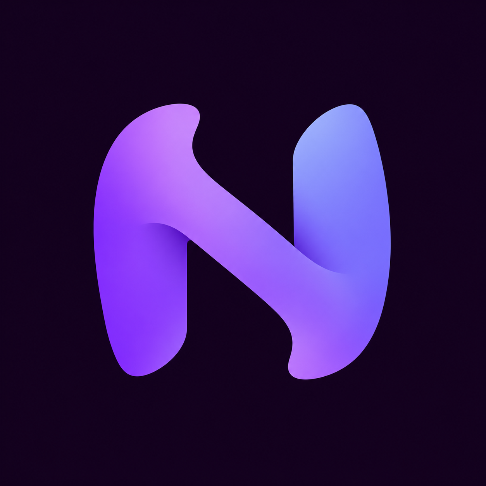

<p align="center"></p>

# NAVA AI — Windows installer

**One offline setup EXE · app launcher included · no target-PC Python or CMD setup**

## Download

### [Download NAVA AI Setup for Windows x64](https://github.com/ZahraRehmat/NavaAI/releases/download/v1.0.1/NAVA-AI-Setup-1.0.1-win-x64.exe)

[Release page](https://github.com/ZahraRehmat/NavaAI/releases/tag/v1.0.1) · [Checksum](SHA256SUMS-1.0.1.txt) · [Validation results](BUILD_VALIDATION-1.0.1.json) · [Today's complete progress](../TODAYS_PROGRESS_2026-11-15.md)

| Item | Value |
| --- | --- |
| File | `NAVA-AI-Setup-1.0.1-win-x64.exe` |
| Size | 870,606,803 bytes · approximately 830 MiB |
| Status | **Unsigned development preview** |
| Target | Windows 10 2004+ / Windows 11, **x64** |
| Tested here | **Windows 11 build 26200** |
| Windows 10 | **Real acceptance testing pending**, especially managed browser support |
| Disk space | Allow roughly 4 GB free during installation |
| Qwen / OpenVINO | **Not included** |
| Target-PC Python/pip | **Not required** |

The binary is attached to the GitHub Release. This folder on `main` contains its guide, checksums and manifests. The application EXE is inside the installer; it needs its private runtime folder and should not be copied out alone.

## Install and start

1. Download Setup above and review the preview limitations below.
2. Run it. Installation is per user under LocalAppData by default.
3. Leave sign-in startup selected for hands-free readiness after login.
4. Setup discovers this PC's apps and known file locations automatically.
5. Start **NAVA AI** from the desktop or Start menu, or let it start after sign-in.
6. When the badge says **Say Nava listen**, say **Nava listen** once, then give commands normally.
7. Say **show dictionary**, **open grid**, or **dictation on** for guidance, pointer controls or voice typing.

The approved violet N logo appears on Setup, the application EXE and shortcuts. The display name is **NAVA AI**; the command name is **Nava**, not NavaAI.

## Included

- Existing direct-control application, native EXE launcher and isolated Python runtime.
- Required app-control, UIA/COM, editing, voice, OCR and browser libraries and dependencies.
- Vosk small English-US for commands, Whisper base.en for dictation, existing punctuation assets and RapidOCR assets.
- Matching Chromium/FFmpeg support, Office catalogs, website directory, aliases, grid/dictionary defaults and icons.
- App-local Microsoft VC runtime and Tcl/Tk, avoiding a separate Python or VC installer.

## Excluded

Qwen weights, OpenVINO, unused Whisper Tiny, the old AI planner, developer virtual environment, personal app catalog, browser profiles, recordings, credentials, checkpoint keys and local logs. Recognition assets above remain because existing features use them.

Setup creates a fresh app catalog on the receiving PC. It does not copy the developer's app paths or personal files. File matching uses the receiving user's folders and current Explorer context on demand.

## Upgrade and uninstall

Preferences survive upgrades. Uninstall removes the application while retaining user settings, profiles, downloads and logs. The isolated acceptance test verified preservation of changed dictionary opacity and a sample download, and confirmed the development startup shortcut was unchanged.

## Verified

- **212** focused source checks passed.
- **19** native/package imports passed in the standalone and installed runtime.
- Command, dictation, punctuation and OCR assets loaded successfully.
- Bundled browser completed an offline labelled smoke check.
- Packaged grid subprocess observed **138** controls.
- Actual fresh install, upgrade and uninstall returned **exit code 0**.

These checks do not certify every app, accent or Windows build. Broader legacy test failures remain documented in [NAVA_RENAME.md](../NAVA_RENAME.md).

## Preview limits

- Windows 10 remains a target, not a completed acceptance result. Current Playwright vendor requirements list Windows 11; test managed-browser controls on real Windows 10 before broad deployment.
- Setup and launcher are unsigned; production distribution needs publisher signing.
- Desktop Office must already be installed. Setup does not install paid Office or silently install Chrome/Edge; managed Chromium is included.
- Microphone privacy settings, elevated apps, protected desktops and the password/PIN screen retain Windows restrictions.
- Optional UIAccess overlays require trusted accessibility deployment; Setup does not silently add certificate trust or bypass Windows security.
- This is not a 32-bit or native ARM64 package.

## Verify the download

```powershell
Get-FileHash .\NAVA-AI-Setup-1.0.1-win-x64.exe -Algorithm SHA256
```

Expected SHA-256:

```text
6c3fe3d73bda55b242bd175e4166115358533c02c066298a22b92053808fd078
```

[Payload manifest](PAYLOAD_MANIFEST.json) · [Package versions/license metadata](THIRD_PARTY_PACKAGES.json) · [Build instructions](../INSTALLER.md) · [Packaging source](../packaging/)
